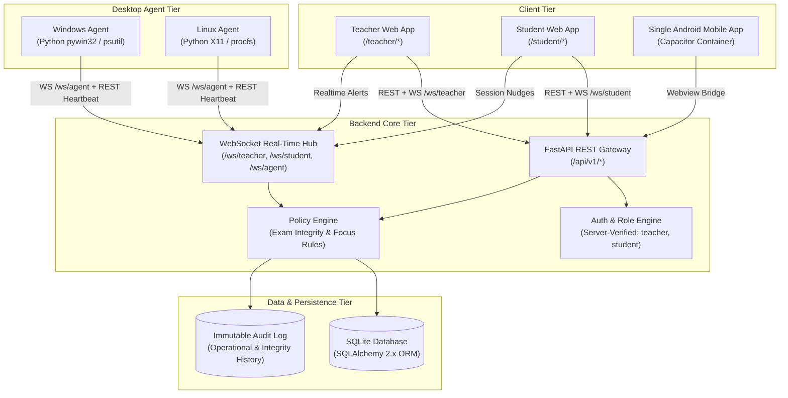

# System Architecture: Smart Classroom Platform

**Project**: Smart Classroom – Exam Integrity & Focus Management System  
**Stage**: Phase 1.1 / Phase 1.2 Architectural Specification  
**Status**: Locked Architecture (Updated: Dual Portal & Role-Based Security)  

---

## 1. System Philosophy & Ethical Foundation

The Smart Classroom platform delivers a balanced environment for academic rigor and focused productivity through two distinct, policy-driven modes:
1. **Exam Mode**: Guarantees proctoring integrity, device attestation, and verifiable event streams during high-stakes assessments.
2. **Focus Mode**: Provides students with structured, distraction-free study blocks using Pomodoro rhythms, local attention nudges, and wellness analytics.

### Exactly Two Application Roles
The system supports **strictly two roles**:
- **`teacher`**: The primary administrative authority. Endowed with administrative privileges for classroom management, examination orchestration, candidate device supervision, Focus Mode oversight, report analysis, and alert adjudication.
- **`student`**: Enrolled candidate and self-directed learner. Capable of joining classrooms via enrollment codes, sitting for authorized exams, and managing personal Focus sessions.

There is **no separate `admin` role**; teacher accounts serve as the designated administrators of their academic environments.

### Ethical & Privacy Manifesto
The system strictly adheres to **visible, authorized, and transparent monitoring**:
- **Prohibited Capabilities**: The platform **NEVER** implements keystroke logging, background password harvesting, secret webcam or microphone access, unauthorized clipboard scraping, remote shell execution, or hidden surveillance.
- **Explicit Attestation**: In Exam Mode, desktop agents register with an explicit student consent handshake. Active monitoring is indicated by persistent visual status indicators.
- **Explainable Alerts**: No student is penalized by an opaque automated score. All alerts are accompanied by structured, verifiable evidence (timestamp, window title change, process start, or multi-display connection) for teacher review and human adjudication.

---

## 2. Separate Portal Experiences (Shared Infrastructure)

Both portals are delivered within a **single unified React application** and backed by **one FastAPI service**, yet offer completely distinct, protected portal layouts and navigation.

```mermaid
flowchart TD
    subgraph Single React Web App
        ROUTER["React Router (BrowserRouter)"]
        
        subgraph Teacher Portal Group ["/teacher/* (Role: teacher)"]
            T_LOGIN["/teacher/login"]
            T_DASH["/teacher/dashboard"]
            T_CLS["/teacher/classrooms"]
            T_EXM["/teacher/exams"]
            T_FOC["/teacher/focus"]
            T_DEV["/teacher/devices"]
            T_NOT["/teacher/notifications"]
            T_REP["/teacher/reports"]
        end

        subgraph Student Portal Group ["/student/* (Role: student)"]
            S_LOGIN["/student/login"]
            S_DASH["/student/dashboard"]
            S_CLS["/student/classrooms"]
            S_EXM["/student/exams"]
            S_FOC["/student/focus"]
            S_HIS["/student/history"]
            S_NOT["/student/notifications"]
        end
    end

    ROUTER --> Teacher Portal Group
    ROUTER --> Student Portal Group

    Teacher Portal Group -->|JWT Role: teacher| API_GATEWAY["Unified FastAPI Backend (/api/v1/*)"]
    Student Portal Group -->|JWT Role: student| API_GATEWAY
```

### 2.1 Teacher Portal (`/teacher/*`)
Dedicated layout with administrative sidebar, proctoring metrics, and classroom tools:
- `/teacher/login`: Dedicated instructor entry point.
- `/teacher/dashboard`: Live overview of active cohorts, connected lab devices, and critical alert queue.
- `/teacher/classrooms`: Cohort creation, join-code rotation, and student roster auditing.
- `/teacher/exams`: Examination designer, policy rule configuration, and real-time proctoring console.
- `/teacher/focus`: Cross-classroom study session overview and aggregate focus trends.
- `/teacher/devices`: Registered workstation registry, heartbeat health grid, and hardware status.
- `/teacher/notifications`: Administrative dispatches and operational reminders.
- `/teacher/reports`: Academic integrity incident dossiers and audit exports.

### 2.2 Student Portal (`/student/*`)
Distraction-free, modern interface focused on personal achievement and clear exam instructions:
- `/student/login`: Student credential entry and device binding status.
- `/student/dashboard`: Daily schedule, active classroom feeds, and quick-launch for exams and focus.
- `/student/classrooms`: Enrolled courses, teacher contacts, and enrollment code entry dialog.
- `/student/exams`: Examination portal with hardware pre-check, join PIN, and live timer.
- `/student/focus`: Pomodoro workstation with customizable timer, study goals, and gentle nudges.
- `/student/history`: Personal focus logs, study duration streaks, and self-improvement metrics.
- `/student/notifications`: Teacher announcements, schedule changes, and gentle nudges.

---

## 3. 4-Tier System Topology



---

## 4. Role Enforcement & Provisioning Architecture

1. **Server-Verified Roles**:
   - The frontend is **never trusted** to assign roles directly.
   - Public self-registration defaults to role `student`.
   - Teacher accounts require controlled provisioning (e.g., a secured instructor provisioning code or pre-approved institutional invite key verified exclusively on the server).
2. **Endpoint-Level Authorization**:
   - Every protected REST route checks the authenticated user's server-signed JWT role.
   - Any attempt by a `student` token to invoke `/api/v1/classrooms` creation or `/api/v1/exams` management is rejected with HTTP `403 Forbidden`.
3. **Classroom Enrollment Boundary**:
   - Students cannot self-insert into arbitrary classes. Enrollment is gated strictly by valid 6-8 character classroom join codes generated and owned by teachers.

4. **Desktop Agent Device-Scoped Security**:
   - Background agents never store student passwords, teacher tokens, or session cookies.
   - Pairing is initiated from the Student Portal via short-lived (10-minute) single-use pairing codes.
   - The agent receives a scoped device JWT (`role: agent`) tied strictly to the student's hardware UUID.
   - Single-active-device policy: registering a new device marks older devices inactive to prevent unauthorized proxy computing.
   - Devices can be instantly revoked from the Student or Teacher portals.

---

## 5. Mobile Architecture

- **Single Android Application**: Powered by Capacitor.
- Reuses the unified React codebase without duplicating views or maintaining two independent APKs.
- Inspects the authenticated user's server-verified role upon login and routes automatically to either the Teacher or Student mobile experience.

---

## 6. Phase Evolution Roadmap

```mermaid
flowchart LR
    subgraph Phase 1: 3-Hour Foundation
        P1_1["1.1 Audit & Foundation (Done)"] --> P1_2["1.2 FastAPI Backend Core (Active)"]
        P1_2 --> P1_3["1.3 Frontend Unification (Dual Portals)"]
        P1_3 --> P1_4["1.4 Python Desktop Agent"]
        P1_4 --> P1_5["1.5 Core Integration"]
        P1_5 --> P1_6["1.6 Mobile & Demo Verification"]
    end

    subgraph Phase 2: 24-Hour Advanced Expansion
        P1_6 --> P2_1["2.1 Stabilization & Audit"]
        P2_1 --> P2_2["2.2 Advanced Classroom Mgmt"]
        P2_2 --> P2_3["2.3 Advanced OS Monitoring"]
        P2_3 --> P2_4["2.4 Advanced Exam Integrity"]
        P2_4 --> P2_5["2.5 Advanced Focus Analytics"]
        P2_5 --> P2_6["2.6 Android & Push Notifications"]
        P2_6 --> P2_7["2.7 Evidence, Reports & Exports"]
        P2_7 --> P2_8["2.8 Hardening & Final Demo"]
    end
```


