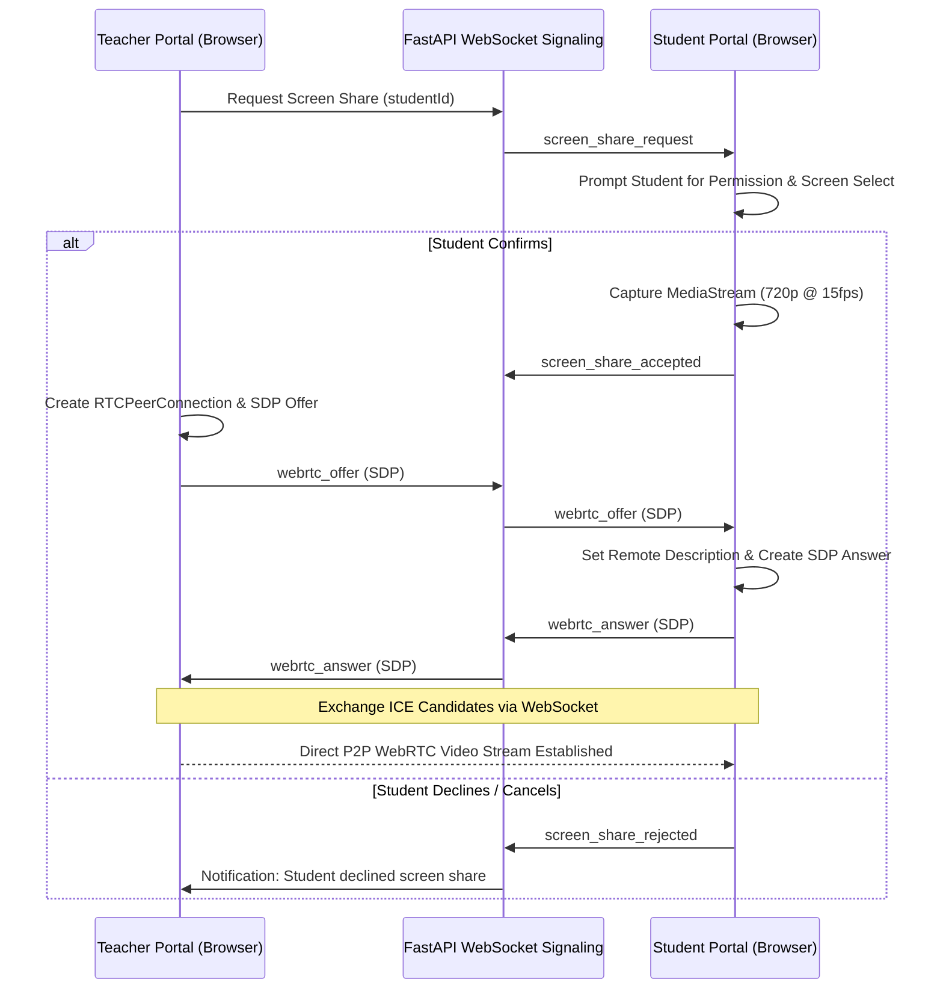

# SATARK System Architecture — Local LAN & Offline Specification

**Team**: WEBFARM (Vedant Patil, Amol Khumbar, Om Mohite, Maruti Shinde)  
**Project**: SATARK — Smart Classroom Integrity & Focus Management Platform  
**Status**: Fully Local, Offline LAN Architecture (Zero Cloud, Zero Docker)  

---

## 1. System Philosophy & Ethical Foundation

SATARK delivers a balanced environment for academic assessment integrity and focused productivity through two distinct, policy-driven operational modes:
1. **Exam Mode**: Guarantees proctoring integrity, candidate device attestation, verifiable window/process activity timelines, and live peer-to-peer screen monitoring during examinations.
2. **Focus Mode**: Provides students with distraction-free study blocks using Pomodoro rhythms, edge vision nudges (OpenCV Haar cascades and Teachable Machine models), and 7-day persisted productivity analytics.

### Strictly Two Application Roles
The system supports **strictly two roles**:
- **`teacher`**: The primary administrative authority. Endowed with privileges for classroom management, examination creation, candidate workstation attestation, live screen monitoring (up to 5 concurrent streams), report analysis, and alert adjudication.
- **`student`**: Enrolled candidate and self-directed learner. Capable of joining classrooms via enrollment codes, taking authorized exams, approving screen sharing with explicit controls, and running private Focus sessions.

There is **no separate `admin` role**; teacher accounts serve as administrators of their academic environments.

### Ethical & Privacy Manifesto
The system strictly adheres to **visible, authorized, and transparent monitoring**:
- **Prohibited Capabilities**: The platform **NEVER** implements keystroke logging, background password harvesting, secret webcam or microphone access, unauthorized clipboard scraping, remote shell execution, or hidden surveillance.
- **Explicit Attestation**: In Exam Mode, desktop agents register with an explicit student consent handshake. Active monitoring is indicated by persistent visual status indicators.
- **Explainable Alerts**: No student is penalized by an opaque automated score. All alerts are accompanied by structured, verifiable evidence (timestamp, window title change, process start, or multi-display connection) for teacher review and human adjudication.
- **Consent-Driven Screen Sharing**: Students must explicitly approve screen sharing via browser prompt, a prominent red status banner confirms live sharing, and the student retains a one-click "Stop Sharing" button at all times.

---

## 2. Local LAN Topology & Monorepo Architecture

The entire SATARK suite runs completely offline on a single Windows host computer, allowing multiple student workstations, teacher laptops, and Android mobile devices to connect over the same Wi-Fi network or mobile hotspot without Docker or cloud servers.

```mermaid
flowchart TD
    subgraph Host_Machine ["Windows Host Computer (e.g. 10.106.76.105)"]
        subgraph Portals ["Independent Frontends (Vite)"]
            T_APP["apps/teacher-portal (Port 5174)"]
            S_APP["apps/student-portal (Port 5173)"]
        end

        subgraph Monorepo_Packages ["Shared Packages"]
            PKG_TYPES["@satark/shared-types"]
            PKG_API["@satark/shared-api"]
            PKG_AUTH["@satark/shared-auth (Local JWT)"]
            PKG_UI["@satark/shared-ui (Radix + Tailwind)"]
            PKG_CFG["@satark/shared-config"]
        end

        subgraph Backend ["FastAPI Unified Application Server (Port 8000)"]
            API["FastAPI REST Endpoints (/api/v1/*)"]
            WS_SIG["WebSocket Hub (/ws/events, /ws/agent, /ws/webrtc)"]
            WEBRTC["Native WebRTC Signaling & Session Manager"]
            STORAGE["Local Media Storage (/storage/evidence, /uploads)"]
        end

        subgraph Central_DB ["Central SQLite Database"]
            SQLITE[("data/satark.db (WAL Mode, FK=ON)")]
        end

        T_APP --> Monorepo_Packages
        S_APP --> Monorepo_Packages
        T_APP -->|HTTP & WS| Backend
        S_APP -->|HTTP & WS| Backend
        API --> SQLITE
        WS_SIG --> SQLITE
        STORAGE --> Host_Machine
    end

    subgraph LAN_Clients ["LAN Client Devices (Same Wi-Fi / Mobile Hotspot)"]
        STUDENT_PC_1["Student Laptop 1 (Browser: Port 5173 + Desktop Agent)"]
        STUDENT_PC_2["Student Laptop 2 (Browser: Port 5173 + Desktop Agent)"]
        STUDENT_PC_N["Student Laptops 3..5 (Browser + Agent)"]
        ANDROID_DEV["Android Mobile Devices (Capacitor APK)"]
    end

    STUDENT_PC_1 <-->|HTTP / WS: 8000| Backend
    STUDENT_PC_2 <-->|HTTP / WS: 8000| Backend
    STUDENT_PC_N <-->|HTTP / WS: 8000| Backend
    ANDROID_DEV <-->|HTTP / WS: 8000| Backend

    STUDENT_PC_1 <===>|Native WebRTC P2P Video Stream| T_APP
    STUDENT_PC_2 <===>|Native WebRTC P2P Video Stream| T_APP
    STUDENT_PC_N <===>|Native WebRTC P2P Video Stream| T_APP
```

---

## 3. Teacher-Centred Native WebRTC Star Topology (No SFU, No Docker)

Rather than running a heavy Selective Forwarding Unit (SFU) like LiveKit inside Docker, SATARK implements a lightweight **Teacher-Centred WebRTC Star Topology**:
- **Signaling Broker**: FastAPI WebSockets (`/ws/webrtc`) acts as the SDP offer/answer and ICE candidate broker.
- **Direct P2P Media Streams**: Up to 5 student workstations create direct `RTCPeerConnection` video tracks directly to the teacher portal's browser.
- **Bandwidth Optimization**: Screen sharing streams are constrained to 720p @ 15fps with a maximum bitrate of 800 kbps, ensuring smooth playback on standard 2.4 GHz / 5 GHz Wi-Fi routers without packet congestion.
- **ICE Configuration**: Local LAN ICE candidate exchange (`typ host`) enables direct peer connections between client machines on the subnet without needing external STUN/TURN servers.
- **Zero Docker Footprint**: The entire system runs natively in Python and Node.js on the host Windows machine.



---

## 4. Centralized SQLite Database Architecture

- **Path**: `data/satark.db` (anchored dynamically to project root).
- **Concurrency & Integrity**:
  - `PRAGMA foreign_keys = ON;` enforces referential integrity.
  - `PRAGMA journal_mode = WAL;` enables concurrent reads alongside active writes without database lock contention.
  - `PRAGMA busy_timeout = 5000;` provides a 5-second lock queue before raising busy exceptions.
- **Direct Access Prohibition**: Only the FastAPI application server interacts with `data/satark.db`. Client applications and student workstations never access SQLite files directly.
- **Schema Compatibility View**: `CREATE VIEW IF NOT EXISTS profiles AS SELECT * FROM users;` bridges legacy profile references with zero disruption.
- **Automated Backup Support**: Timestamped copies saved via `python -m backend.app.cli backup-db` into `data/backups/`.

---

## 5. Security & Authentication Model

1. **Local Password Hashing**: Passwords stored using `passlib[bcrypt]` with unique salts.
2. **Local JWT Tokens**: Generated using local signing secret (`SATARK_SECRET_KEY`) stored strictly on the backend (`backend/.env`). Never leaked to frontend portals.
3. **Token Revocation**: Immediate in-memory blacklist invalidates tokens on user logout.
4. **Desktop Agent Attestation**: Uses single-use 6-character alphanumeric pairing codes (e.g. `8K2NP4`) with 10-minute validity. Once redeemed, the agent receives an ephemeral device token linked strictly to that candidate workstation.
5. **Path Traversal Protection**: Evidence uploads verify file size, validate MIME types (JPEG, PNG, WebP), and sanitize file names using UUIDs (`storage/evidence/<uuid>.jpg`).
