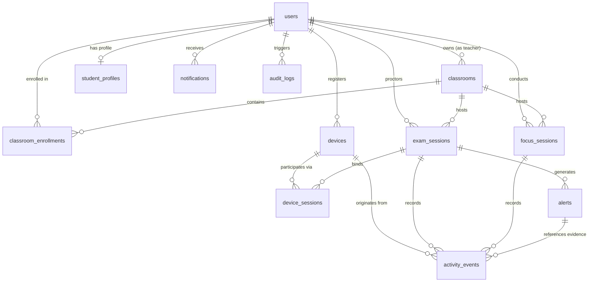

# Database Schema Specification

**Project**: Smart Classroom – Exam Integrity & Focus Management System  
**Database Engine**: SQLite 3 (Phase 1 evaluation) with forward-compatibility to PostgreSQL (Phase 2)  
**ORM**: SQLAlchemy 2.0 (Declarative Base) with Pydantic v2 validation  
**Roles**: Strictly `teacher` (administrative) and `student` (learner)  

---

## 1. Entity Classification Matrix

Entities are classified into Shared Foundation, Exam Mode Specific, and Focus Mode Specific modules:

| Entity | Module | Classification | Description |
| :--- | :--- | :--- | :--- |
| `users` | Shared | Core Auth | Teachers (administrative authority) and students. |
| `student_profiles` | Shared | Identity | Student roster attributes, division, roll number, major. |
| `classrooms` | Shared | Academic | Classroom cohorts, course codes, join codes, teacher owner. |
| `classroom_enrollments`| Shared | Academic | Student membership in classrooms. |
| `devices` | Shared | Hardware | Desktop hardware registry, OS metadata, agent UUID. |
| `device_sessions` | Shared | Hardware | Association between an active session, a student, and a device. |
| `exam_sessions` | Exam Mode | Mode Core | Proctored assessment lifecycle, policy rules, and timing. |
| `focus_sessions` | Focus Mode | Mode Core | Pomodoro study sessions, targets, work/break interval logs. |
| `activity_events` | Shared Envelope | Telemetry | Ingested agent events with deduplication and payload details. |
| `alerts` | Exam / Shared | Integrity | Rule violation alerts with evidence, severity, and teacher review. |
| `notifications` | Shared | User Comms | User-facing system notices, nudges, and announcements. |
| `audit_logs` | Shared | Compliance | Immutable append-only audit trail for administrative operations. |

---

## 2. Entity-Relationship Diagram



---

## 3. Detailed Entity Definitions & Field Schemas

### 3.1 `users` (Shared)
Central identity entity storing credentials, role, and account status.
Supported roles: strictly `'teacher'` and `'student'`.
```sql
CREATE TABLE users (
    id VARCHAR(36) PRIMARY KEY,              -- UUIDv4 string
    email VARCHAR(255) NOT NULL UNIQUE,      -- Standardized lowercase email
    hashed_password VARCHAR(255) NOT NULL,   -- Secure password hash
    full_name VARCHAR(120) NOT NULL,         -- Display name
    role VARCHAR(20) NOT NULL,               -- Strictly 'teacher' or 'student'
    is_active BOOLEAN NOT NULL DEFAULT 1,
    created_at DATETIME NOT NULL DEFAULT CURRENT_TIMESTAMP,
    updated_at DATETIME NOT NULL DEFAULT CURRENT_TIMESTAMP
);

CREATE INDEX idx_users_email ON users(email);
CREATE INDEX idx_users_role ON users(role);
```

### 3.2 `student_profiles` (Shared)
Additional academic attributes for users with role `student`.
```sql
CREATE TABLE student_profiles (
    id VARCHAR(36) PRIMARY KEY,
    user_id VARCHAR(36) NOT NULL UNIQUE REFERENCES users(id) ON DELETE CASCADE,
    student_id_number VARCHAR(50) NOT NULL UNIQUE, -- Institutional roll / student number
    branch_or_major VARCHAR(100),                  -- e.g. "Computer Science"
    semester INTEGER,                              -- e.g. 6
    avatar_url VARCHAR(500),
    created_at DATETIME NOT NULL DEFAULT CURRENT_TIMESTAMP
);

CREATE INDEX idx_student_profiles_user ON student_profiles(user_id);
```

### 3.3 `classrooms` (Shared)
Course cohorts created and administered by teachers.
```sql
CREATE TABLE classrooms (
    id VARCHAR(36) PRIMARY KEY,
    teacher_id VARCHAR(36) NOT NULL REFERENCES users(id) ON DELETE RESTRICT,
    title VARCHAR(150) NOT NULL,
    subject_code VARCHAR(30),
    description TEXT,
    join_code VARCHAR(8) NOT NULL UNIQUE,         -- 6-8 char enrollment invite code
    is_archived BOOLEAN NOT NULL DEFAULT 0,
    created_at DATETIME NOT NULL DEFAULT CURRENT_TIMESTAMP
);

CREATE INDEX idx_classrooms_teacher ON classrooms(teacher_id);
CREATE INDEX idx_classrooms_join_code ON classrooms(join_code);
```

### 3.4 `classroom_enrollments` (Shared)
Many-to-many relationship linking students to classrooms.
```sql
CREATE TABLE classroom_enrollments (
    id VARCHAR(36) PRIMARY KEY,
    classroom_id VARCHAR(36) NOT NULL REFERENCES classrooms(id) ON DELETE CASCADE,
    student_id VARCHAR(36) NOT NULL REFERENCES users(id) ON DELETE CASCADE,
    enrolled_at DATETIME NOT NULL DEFAULT CURRENT_TIMESTAMP,
    UNIQUE(classroom_id, student_id)
);

CREATE INDEX idx_enrollments_classroom ON classroom_enrollments(classroom_id);
CREATE INDEX idx_enrollments_student ON classroom_enrollments(student_id);
```

### 3.5 `devices` (Shared)
Physical testing machines and student laptops running the desktop agent.
```sql
CREATE TABLE devices (
    id VARCHAR(36) PRIMARY KEY,                   -- Generated device UUID
    hardware_uuid VARCHAR(100) NOT NULL UNIQUE,   -- Motherboard/CPU hash fingerprint
    hostname VARCHAR(120),                        -- Machine local name (e.g. "LAB-PC-01")
    os_type VARCHAR(20) NOT NULL,                 -- 'windows', 'linux', 'macos'
    os_version VARCHAR(50),                       -- e.g. "Windows 11 Build 22631"
    agent_version VARCHAR(20) NOT NULL,           -- e.g. "1.0.0"
    owner_user_id VARCHAR(36) REFERENCES users(id) ON DELETE SET NULL,
    last_heartbeat_at DATETIME,
    status VARCHAR(20) NOT NULL DEFAULT 'offline',-- 'connected', 'inactive', 'offline'
    created_at DATETIME NOT NULL DEFAULT CURRENT_TIMESTAMP
);

CREATE INDEX idx_devices_hardware_uuid ON devices(hardware_uuid);
CREATE INDEX idx_devices_status ON devices(status);
```

### 3.6 `device_sessions` (Shared)
Active binding between a device, a student, and an ongoing exam or focus session.
```sql
CREATE TABLE device_sessions (
    id VARCHAR(36) PRIMARY KEY,
    device_id VARCHAR(36) NOT NULL REFERENCES devices(id) ON DELETE RESTRICT,
    student_id VARCHAR(36) NOT NULL REFERENCES users(id) ON DELETE RESTRICT,
    session_id VARCHAR(36) NOT NULL,              -- References exam_sessions.id or focus_sessions.id
    mode VARCHAR(10) NOT NULL,                    -- 'exam' | 'focus'
    connected_at DATETIME NOT NULL DEFAULT CURRENT_TIMESTAMP,
    disconnected_at DATETIME,
    is_active BOOLEAN NOT NULL DEFAULT 1
);

CREATE INDEX idx_device_sessions_device ON device_sessions(device_id);
CREATE INDEX idx_device_sessions_session ON device_sessions(session_id);
```

### 3.7 `exam_sessions` (Exam Mode)
Formal examinations created and monitored by teachers.
```sql
CREATE TABLE exam_sessions (
    id VARCHAR(36) PRIMARY KEY,
    classroom_id VARCHAR(36) NOT NULL REFERENCES classrooms(id) ON DELETE RESTRICT,
    teacher_id VARCHAR(36) NOT NULL REFERENCES users(id) ON DELETE RESTRICT,
    title VARCHAR(150) NOT NULL,
    description TEXT,
    exam_code VARCHAR(10) NOT NULL UNIQUE,        -- Short access code for students
    duration_minutes INTEGER NOT NULL DEFAULT 60,
    scheduled_start DATETIME NOT NULL,
    actual_start DATETIME,
    actual_end DATETIME,
    status VARCHAR(20) NOT NULL DEFAULT 'draft',  -- 'draft', 'scheduled', 'active', 'paused', 'ended'
    policy_config JSON NOT NULL,                  -- Integrity rules (window_blur, blacklists, multi-screen)
    created_at DATETIME NOT NULL DEFAULT CURRENT_TIMESTAMP
);

CREATE INDEX idx_exams_classroom ON exam_sessions(classroom_id);
CREATE INDEX idx_exams_teacher ON exam_sessions(teacher_id);
CREATE INDEX idx_exams_status ON exam_sessions(status);
```

### 3.8 `focus_sessions` (Focus Mode)
Self-directed or classroom-guided Pomodoro study sessions.
```sql
CREATE TABLE focus_sessions (
    id VARCHAR(36) PRIMARY KEY,
    student_id VARCHAR(36) NOT NULL REFERENCES users(id) ON DELETE CASCADE,
    classroom_id VARCHAR(36) REFERENCES classrooms(id) ON DELETE SET NULL,
    goal_title VARCHAR(200) NOT NULL,
    planned_duration_minutes INTEGER NOT NULL DEFAULT 25,
    actual_focus_seconds INTEGER NOT NULL DEFAULT 0,
    actual_break_seconds INTEGER NOT NULL DEFAULT 0,
    status VARCHAR(20) NOT NULL DEFAULT 'active', -- 'active', 'paused', 'completed', 'abandoned'
    started_at DATETIME NOT NULL DEFAULT CURRENT_TIMESTAMP,
    ended_at DATETIME,
    notes TEXT
);

CREATE INDEX idx_focus_student ON focus_sessions(student_id);
CREATE INDEX idx_focus_status ON focus_sessions(status);
```

### 3.9 `activity_events` (Shared Telemetry Envelope)
Time-series activity events logged by desktop agents.
```sql
CREATE TABLE activity_events (
    id VARCHAR(36) PRIMARY KEY,                   -- event_id (UUIDv4) for deduplication
    device_id VARCHAR(36) REFERENCES devices(id) ON DELETE RESTRICT, -- Nullable for web_client events
    student_id VARCHAR(36) NOT NULL REFERENCES users(id) ON DELETE RESTRICT,
    classroom_id VARCHAR(36) REFERENCES classrooms(id) ON DELETE SET NULL,
    session_id VARCHAR(36) NOT NULL,              -- exam_sessions.id or focus_sessions.id
    mode VARCHAR(10) NOT NULL,                    -- 'exam' | 'focus'
    event_category VARCHAR(30) NOT NULL,          -- 'activity_event', 'heartbeat', 'connectivity_event'
    event_type VARCHAR(50) NOT NULL,              -- 'window_blur', 'tab_switch', 'restricted_app', etc.
    source VARCHAR(20) NOT NULL DEFAULT 'agent',  -- 'agent', 'server', 'demo', 'web_client'
    severity VARCHAR(20) NOT NULL DEFAULT 'low',  -- 'low', 'medium', 'high', 'critical'
    occurred_at DATETIME NOT NULL,
    received_at DATETIME NOT NULL DEFAULT CURRENT_TIMESTAMP,
    details JSON NOT NULL                         -- Structured event parameters
);

CREATE INDEX idx_events_session ON activity_events(session_id);
CREATE INDEX idx_events_occurred_at ON activity_events(occurred_at);
CREATE INDEX idx_events_type ON activity_events(event_type);
```

### 3.10 `alerts` (Exam & Shared Integrity Alerts)
Rule-engine violations triggered from activity events requiring teacher review.
```sql
CREATE TABLE alerts (
    id VARCHAR(36) PRIMARY KEY,
    session_id VARCHAR(36) NOT NULL,              -- Typically exam_sessions.id
    student_id VARCHAR(36) NOT NULL REFERENCES users(id) ON DELETE CASCADE,
    device_id VARCHAR(36) REFERENCES devices(id) ON DELETE RESTRICT, -- Nullable for web_client alerts
    primary_event_id VARCHAR(36) REFERENCES activity_events(id) ON DELETE SET NULL,
    alert_type VARCHAR(50) NOT NULL,
    severity VARCHAR(20) NOT NULL,                -- 'low', 'medium', 'high', 'critical'
    description TEXT NOT NULL,
    evidence_summary JSON,
    is_acknowledged BOOLEAN NOT NULL DEFAULT 0,
    acknowledged_by VARCHAR(36) REFERENCES users(id) ON DELETE SET NULL,
    acknowledged_at DATETIME,
    proctor_notes TEXT,
    created_at DATETIME NOT NULL DEFAULT CURRENT_TIMESTAMP
);

CREATE INDEX idx_alerts_session ON alerts(session_id);
CREATE INDEX idx_alerts_acknowledged ON alerts(is_acknowledged);
```

### 3.11 `exam_questions` (Exam Mode Assessment Content)
Multiple-choice questions with answer choices and point weights.
```sql
CREATE TABLE exam_questions (
    id VARCHAR(36) PRIMARY KEY,
    exam_id VARCHAR(36) NOT NULL REFERENCES exam_sessions(id) ON DELETE CASCADE,
    question_text TEXT NOT NULL,
    options JSON NOT NULL,                        -- Array of 4 string options
    correct_option_index INTEGER NOT NULL,        -- Index (0-3) of the correct answer
    marks INTEGER NOT NULL DEFAULT 1,
    order_num INTEGER NOT NULL DEFAULT 1,
    created_at DATETIME NOT NULL DEFAULT CURRENT_TIMESTAMP,
    updated_at DATETIME NOT NULL DEFAULT CURRENT_TIMESTAMP
);

CREATE INDEX idx_questions_exam ON exam_questions(exam_id);
```

### 3.12 `exam_submissions` (Candidate Submissions & Auto-Graded Scores)
Completed candidate exam assessments with objective server-side evaluation.
```sql
CREATE TABLE exam_submissions (
    id VARCHAR(36) PRIMARY KEY,
    exam_id VARCHAR(36) NOT NULL REFERENCES exam_sessions(id) ON DELETE CASCADE,
    student_id VARCHAR(36) NOT NULL REFERENCES users(id) ON DELETE CASCADE,
    score INTEGER,                                -- Scored marks (withheld during active exam)
    total_marks INTEGER,
    percentage INTEGER,
    status VARCHAR(20) NOT NULL DEFAULT 'submitted', -- 'in_progress', 'submitted', 'graded'
    submitted_at DATETIME NOT NULL DEFAULT CURRENT_TIMESTAMP,
    created_at DATETIME NOT NULL DEFAULT CURRENT_TIMESTAMP,
    CONSTRAINT uq_exam_student_submission UNIQUE (exam_id, student_id)
);

CREATE INDEX idx_submissions_exam ON exam_submissions(exam_id);
CREATE INDEX idx_submissions_student ON exam_submissions(student_id);
```

### 3.13 `student_answers` (Persisted Question Choices)
Candidate responses recorded and auto-saved per question.
```sql
CREATE TABLE student_answers (
    id VARCHAR(36) PRIMARY KEY,
    submission_id VARCHAR(36) REFERENCES exam_submissions(id) ON DELETE CASCADE,
    exam_id VARCHAR(36) NOT NULL REFERENCES exam_sessions(id) ON DELETE CASCADE,
    student_id VARCHAR(36) NOT NULL REFERENCES users(id) ON DELETE CASCADE,
    question_id VARCHAR(36) NOT NULL REFERENCES exam_questions(id) ON DELETE CASCADE,
    selected_option_index INTEGER,                -- Selected choice index (0-3)
    is_correct BOOLEAN,
    marks_awarded INTEGER NOT NULL DEFAULT 0,
    answered_at DATETIME NOT NULL DEFAULT CURRENT_TIMESTAMP,
    CONSTRAINT uq_student_question_answer UNIQUE (student_id, question_id)
);

CREATE INDEX idx_answers_student ON student_answers(student_id);
CREATE INDEX idx_answers_exam ON student_answers(exam_id);
```
```

### 3.11 `notifications` (Shared)
User-directed announcements and focus nudges.
```sql
CREATE TABLE notifications (
    id VARCHAR(36) PRIMARY KEY,
    user_id VARCHAR(36) NOT NULL REFERENCES users(id) ON DELETE CASCADE,
    title VARCHAR(150) NOT NULL,
    message TEXT NOT NULL,
    notification_type VARCHAR(30) NOT NULL,       -- 'exam_announcement', 'focus_nudge', 'security'
    is_read BOOLEAN NOT NULL DEFAULT 0,
    created_at DATETIME NOT NULL DEFAULT CURRENT_TIMESTAMP
);

CREATE INDEX idx_notifications_user ON notifications(user_id, is_read);
```

### 3.12 `audit_logs` (Shared Compliance Log)
Immutable record of security and administrative operations.
```sql
CREATE TABLE audit_logs (
    id VARCHAR(36) PRIMARY KEY,
    actor_user_id VARCHAR(36) REFERENCES users(id) ON DELETE SET NULL,
    action VARCHAR(80) NOT NULL,                  -- 'EXAM_STARTED', 'ALERT_ACKNOWLEDGED', etc.
    target_resource VARCHAR(80),
    ip_address VARCHAR(45),
    details JSON,
    timestamp DATETIME NOT NULL DEFAULT CURRENT_TIMESTAMP
);

CREATE INDEX idx_audit_timestamp ON audit_logs(timestamp);
CREATE INDEX idx_audit_actor ON audit_logs(actor_user_id);
```
